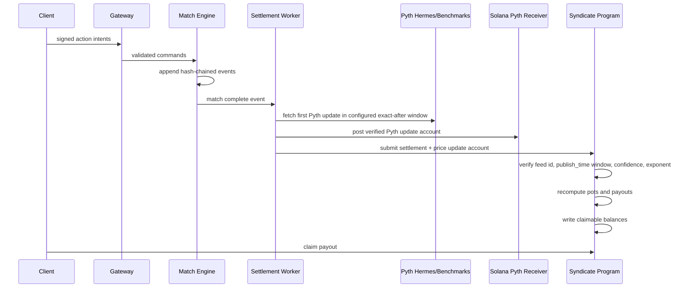
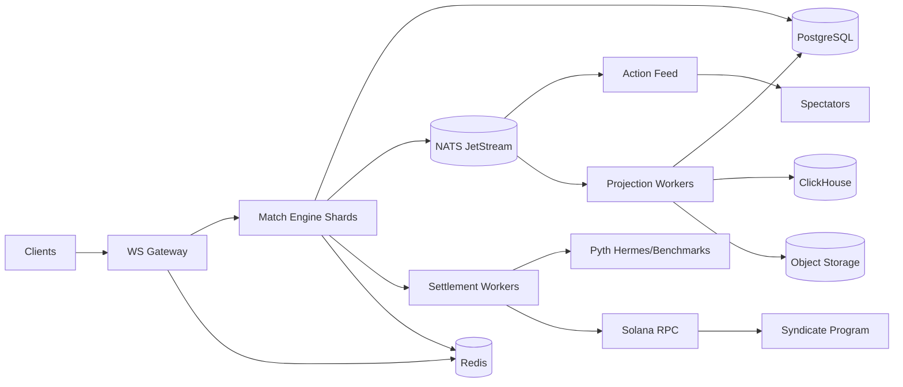

# Syndicate Production Readiness Review

**Status:** Prompt 3 decision artifact, v1.0
**Date:** 2026-06-25
**Scope:** End-to-end architecture, codebase, operations, and implementation plan

This document follows `prompt_3.md`. It treats the existing docs and implementation as proposals, not as binding truth. The review conclusion is direct:

**Syndicate is not yet approved for real-money mainnet.** The deterministic poker/pot core is a useful foundation, and Phases 0-8 plus the production-deployability pass have rebuilt major parts of the oracle, on-chain settlement, persistence contracts, role model, read path, trust-safety, Redis-capable edge state, and deployment artifacts. The remaining blockers are now narrower: settlement-worker durable queue execution, match-engine daemonization, runtime contract tests, live Postgres/Redis/NATS deployment rehearsal, Rust-worker metrics instrumentation, multisig ceremony, and external audit.

The highest priority correction at original review time was the settlement architecture. The baseline docs and code relied on sampled window median settlement through a pull adapter and named Switchboard as the default; Phases 0-1 moved the canonical path to Pyth bounded exact-after settlement. `prompt_3.md` requires Pyth as canonical and no sampling-based settlement. That requirement is directionally correct for auditability, but the literal phrase "exact market price at the precise match end timestamp" must be defined carefully: an arbitrary real-world continuous-time market price does not exist on-chain. Pyth provides signed discrete price updates with publish times. The production rule must therefore define the exact settlement timestamp as a deterministic Pyth-verifiable timestamp, then require the Solana program to validate the Pyth update directly.

References used for the Pyth-specific design:

- Pyth Solana pull integration: https://docs.pyth.network/price-feeds/core/use-real-time-data/pull-integration/solana
- Pyth historical/benchmark updates: https://docs.pyth.network/price-feeds/core/use-historical-price-data
- Pyth `parsePriceFeedUpdates` timestamp-range semantics: https://api-reference.pyth.network/price-feeds/evm/parsePriceFeedUpdates

## 1. Executive Assessment

### Current strengths

- The deterministic Rust core in `services/shared` has the right shape for real-money systems: integer prices/chips, pot construction, side-pot eligibility, winner selection, ties, rake, and conservation checks.
- The code separates gameplay ordering from fund custody. This is the correct trust boundary: the backend may order actions, but the chain must decide whether money can move.
- The per-match vault direction is correct. Funds are isolated by match in principle, which is mandatory for concurrent real-money games.
- The action-feed service uses allow-list redaction. That is the right posture for sealed predictions and spectator views.
- The docs already identify several serious game-design risks: collusion, forecasting mis-positioning, reveal versus fold tension, and pacing.

### Current weaknesses

- Original review finding, now addressed in Phases 0-1: sampling/window-median settlement and Switchboard defaults were removed from the canonical money path. The legacy `services/oracle-adapter` sampling crate has been fully deleted; Pyth bounded exact-after is the only oracle/settlement path.
- The Solana program now consumes a Pyth Receiver `PriceUpdateV2` account and requires full verification/account ownership before feeding the authenticated price into shared settlement math. This still needs Anchor/LiteSVM runtime tests and external audit before real money.
- Persistence now has Postgres schema/SQL contracts and outbox/projector wiring, but it has not been applied to a live localnet/devnet environment yet.
- Gateway now has Redis-backed one-time challenges, sessions, rate limits, health, metrics, and env startup. Matchmaking now has Redis-backed table state and HTTP admission. Trust-safety enforcement is implemented in source and consumed by matchmaking admission, but production admission still needs provider-grade geolocation, pre-deposit UX, and rehearsal.
- Protocol scoped roles now exist in source; production still needs multisig/timelock authority setup and role-action rehearsal in localnet/devnet.
- The settlement worker now has idempotent job state, retry/dead-letter/refund paths, vault reconciliation seams, Hermes/Receiver HTTP transport hooks, and prepared Solana JSON-RPC send/confirm support.
- Deployment artifacts now include localnet infrastructure, env templates, alert rules, systemd examples, secrets/audit runbooks, and preflight scripts. Application daemons and metrics still need to be fully wired before a third party can deploy the complete product from scratch.

### Immediate blockers

1. Run Anchor/LiteSVM contract tests and independent smart-contract review before any real-money deployment.
2. Wire environment-specific transaction builders/signers and Receiver-posting relayer credentials for localnet/devnet.
3. Apply the Postgres migration and run projector/worker daemons against a real localnet stack.
4. Configure multisig/timelock authorities and rehearse pause/void/claim/upgrade runbooks.
5. Back Phase 7 admission with Postgres active-enforcement queries and add gateway pre-deposit UX/errors before scaling capital.
6. Add deployable application daemons/manifests for gateway, matchmaking, match-engine, settlement-worker, projector, trust-safety, and reconciliation workers.
7. Emit the Prometheus metrics referenced by alert rules from production service endpoints.
8. Run independent smart-contract and deterministic-core audits before any real-money mainnet tier.

### Architectural risks

| Risk | Severity | Why it matters |
|---|---:|---|
| Oracle timestamp ambiguity | Critical | If "exact price" is not deterministic, every settlement can be disputed. |
| On-chain oracle validation gap | Critical | A malicious or compromised backend can submit a plausible but unauthenticated price path today. |
| Filesystem persistence | High | Multiple service instances cannot safely share or recover state. |
| Coarse admin authority | High | One compromised authority can settle, void, or lock capital incorrectly. |
| Collusion/Sybil risk | High | Small tables and wallets make coordinated play economically rational. |
| Demo worker path | High | Settlement liveness, retry, idempotency, and failure recovery exist as traits/tests, but the deployed worker still needs real transaction builders/signers and durable stores. |
| Deployment incompleteness | High | Infra artifacts exist, but app daemons and metrics are not yet complete enough for clean-room production operation. |

## 2. End-to-End System Review

### Smart contracts

Current state: `services/programs` defines per-match accounts, a vault token account, seats, deposit, lock, submit settlement, claim, void, and refund. This is directionally good, but not production safe.

Required changes:

- Add Pyth price update account(s) to `submit_settlement`.
- Store `price_feed_id`, `settlement_timestamp`, `max_publish_time_skew_sec`, `max_confidence`, `expected_exponent`, and `settlement_price` on-chain.
- Validate Pyth account ownership through `PriceUpdateV2`.
- Call Pyth SDK price retrieval with explicit feed-id and age/timestamp checks.
- Require bounded exact-after validation: `scheduled_end_ts <= publish_time <= scheduled_end_ts + oracle_delay_window_sec`, with the first valid Pyth update in that window as the only acceptable settlement price.
- Remove oracle sample vectors from settlement args.
- Add role accounts: `protocol_admin`, `settlement_admin`, `pause_admin`, `fee_admin`, and `upgrade_authority`, all controlled by multisig or governance.
- Add pause flags for new matches and settlement, while preserving claim/refund safety.
- Enforce one claim per seat and verify all settlement seats are present exactly once.
- Add explicit close-account flows after all claims/refunds to reclaim rent.

### Backend systems

Current state: core logic exists, but services are mostly libraries/prototypes.

Required architecture:

- Match engine as a stateful Rust service, one active writer per match.
- PostgreSQL as the transactional system of record for matches, seats, users, config versions, custody ledger mirrors, and read-model checkpoints.
- Kafka, Redpanda, or NATS JetStream for append-only event distribution. For launch simplicity, Postgres outbox plus NATS JetStream is enough.
- Redis for ephemeral sessions, rate limits, matchmaking queues, presence, and lease heartbeats.
- Settlement worker pool with idempotent jobs, durable retries, and Solana transaction confirmation tracking.
- Pyth updater/settlement service that fetches Hermes/Benchmarks updates and submits/uses Pyth price update accounts.
- Separate read-model builders for live games, match history, profiles, leaderboards, replay pages, and spectator views.

### Realtime infrastructure

Current state: `gateway` is a WebSocket server with nonce auth and broadcast. It has no production fan-out, session store, backpressure isolation, or replay resume.

Required architecture:

- Stateless WebSocket gateways behind a load balancer.
- Sticky routing by match id or gateway-to-engine RPC.
- Redis/NATS presence and pub/sub for fan-out.
- Backpressure isolation between gameplay commands and spectator broadcasts.
- Client resume token with last seen event sequence.
- Server-authoritative clock for turns. Client timestamps are never trusted.

### Persistence and data architecture

The filesystem store must be replaced for production.

Canonical storage model:

- PostgreSQL: transactional source of truth for relational state.
- Event log: append-only event table plus object storage export; optional JetStream/Redpanda stream for consumers.
- Redis: volatile cache and coordination.
- ClickHouse: analytics, leaderboards at scale, trust-safety features, and growth metrics.
- S3-compatible object storage: replay bundles, raw signed event logs, settlement bundles, audit exports.

Core tables:

- `users`, `wallet_links`, `profiles`, `profile_stats`
- `matches`, `match_configs`, `match_seats`, `match_transitions`
- `match_events` with `(match_id, seq, event_type, payload_jsonb, prev_hash, hash, signer, created_at)`
- `custody_ledger`, `vault_reconciliations`, `claims`, `refunds`
- `settlements`, `pyth_price_proofs`, `settlement_attempts`
- `leaderboard_snapshots`, `achievements`, `houses`, `chambers`
- `trust_safety_signals`, `enforcement_actions`

CQRS/event sourcing:

- Gameplay state is event-sourced.
- PostgreSQL stores the canonical event log and command-side state.
- Read models are disposable projections and must be rebuildable from the event log.
- Every settlement bundle must include event root, config hash, Pyth proof reference, seat list, and deterministic result.

### User profile system

Profiles are not optional for a premium game. They are also part of trust and retention.

Required model:

- Public profile: handle, avatar, house, chamber, public rank, public match summary.
- Private profile: wallet links, preferences, region compliance flags, device/session metadata, privacy settings.
- Stats: matches played, VPIP-like participation, win/loss, ROI by tier, showdown rate, fold rate, streaks, average settlement distance, collusion risk flags.
- Social graph: follows, muted users, blocked users, chamber membership.
- Achievements: deterministic achievement events derived from match outcomes.

Privacy:

- Public feed should expose pseudonymous seat ids during live matches.
- Wallets should be hidden by default in public UI unless a user opts in.
- Trust-safety signals must not be exposed through public APIs.
- Data retention must separate compliance/audit records from optional personalization data.

### Security posture

Current posture is not yet acceptable for real money.

Required controls:

- Pyth direct on-chain validation.
- Multisig/timelocked program upgrades.
- Separate authority roles.
- Secrets in cloud secret manager or Vault, never `.env` in deploy targets.
- Transaction signing in HSM/KMS-backed key management for relayers.
- CI merge gates for deterministic tests, Solana tests, lint, formatting, and migration checks.
- Runtime reconciliation: vault balance equals expected claim/refund/fee ledger.
- Bug bounty after audit and before uncapped tiers.

### Observability and operations

Required SLOs:

- Settlement verification mismatch: 0 always.
- Vault drift: 0 always.
- Match command p99 ack latency: under 250 ms at launch target.
- Settlement p99: under 60 seconds for bounded exact-after mode, with clear pending state.
- Oracle proof fetch success: above 99.9 percent for supported feeds.
- VOID rate: tracked by reason; Pyth unavailability must be visible as a product/ops metric.

## 3. Final Canonical Architecture

### Canonical settlement rule

Founder decision: use **bounded exact-after settlement**.

- Betting closes at `scheduled_end_ts`.
- The settlement worker asks Pyth for updates beginning at `scheduled_end_ts` and uses the **first valid Pyth price update** whose `publish_time` satisfies `scheduled_end_ts <= publish_time <= scheduled_end_ts + oracle_delay_window_sec`.
- `oracle_delay_window_sec` is configurable per match config and defaults to **5 seconds**.
- The Pyth `publish_time` used becomes the auditable settlement oracle timestamp.
- The Solana program validates feed id, publish time lower bound, publish time upper bound, confidence, exponent, price, and account ownership.
- If no valid update arrives in the configured window, the match VOIDs and refunds with user-facing reason: **"Pyth Oracle price for settlement is unavailable."**
- There is no operator-selected price and no sample median. The admin/worker may search from the lower timestamp, but may only use the first valid Pyth price inside the configured window.

Initial feed defaults are BTC/USD, ETH/USD, and SOL/USD. Supported feeds, feed ids, exponents, confidence limits, and settlement windows must remain configuration-driven so new Pyth feeds can be added without code changes.

### Settlement sequence

### Multi-game contract architecture

PDA design:

- `protocol_state`: global config, role registry, pause flags.
- `match`: seeds `["match", match_id]`.
- `vault`: seeds `["vault", match]`, one SPL token account per match.
- `seat`: seeds `["seat", match, player]`.
- `settlement`: seeds `["settlement", match]`, immutable once written.
- `claim_receipt`: optional closeable receipt for audit.

Capital safety:

- One vault per match. No shared pooled escrow for player funds.
- Deposits only enter the match vault.
- Claims and refunds can only transfer from that match vault.
- Fees are accounted separately and swept only after all player payouts/refunds remain solvent.
- A user can hold multiple seats in different matches with the same wallet; each seat PDA is match-scoped.
- One wallet must not hold multiple seats in the same match. This is a hard launch rule, not only a default.

Authority model:

Production should not run on one omnipotent admin key. Separate roles reduce the blast radius of a compromised key and make operations auditable:

- `settlement_admin`: posts Pyth-backed settlement transactions and retry attempts. It cannot change fees, upgrade the program, withdraw arbitrary funds, or alter match configs.
- `emergency_void_admin`: voids unsettled matches only for documented oracle, timelock, engine, or custody faults. It cannot settle in favor of any player.
- `pause_admin`: pauses new matches, a feed, a tier, or settlement submission during incidents. It must not block already-written claims/refunds.
- `config_admin`: publishes future match configs: feeds, buy-ins, rake, timers, oracle window, geofence list. It cannot mutate a live match's bound config.
- `fee_admin`: updates future fee/rake destinations and rates within protocol caps.
- `treasury_admin`: sweeps only already-accrued protocol fees after solvency checks. It cannot touch player claim/refund reserves.
- `upgrade_authority`: upgrades the program through multisig plus timelock. For launch this can be founder-controlled multisig; as capital grows, move to a longer timelock and eventually freeze/revoke upgrade authority where practical.

Recommended launch controls: a 2-of-3 founder/operator multisig for non-upgrade roles, a 2-of-3 or 3-of-5 multisig for upgrades, 24-hour upgrade timelock on mainnet, and zero timelock on localnet/devnet. All role actions must emit events and be mirrored into the event log.

Claim flow:

- Settlement writes per-seat `payout`.
- Players claim idempotently.
- Refund path writes/uses original deposit plus refundable entry fee.
- Program rejects double claims.

### Backend architecture

Launch target of 1,000-2,000 concurrent users can run with:

- 2-3 gateway replicas.
- 2-4 engine replicas, sharded by match id.
- 2 settlement worker replicas.
- Bare-metal/VPS Postgres on the primary host, with a second VPS for backup/standby once real capital is live.
- Bare-metal/VPS Redis.
- NATS JetStream single-node for launch; clustered later.
- MinIO or filesystem-backed object storage for local/devnet; S3-compatible remote backup for mainnet once real capital grows.
- ClickHouse can be deferred until analytics volume demands it, but events must be exportable from day one.

## 4. Gap Analysis

| Component | Current State | Required State | Priority |
|---|---|---|---|
| Oracle settlement | Bounded exact-after Pyth model in shared/config; authenticated Receiver account consumed on-chain | Exercise on localnet/devnet and audit | P1 |
| Shared settlement input | Single `VerifiedOraclePrice` in canonical `SettleInput` | Keep sample vectors out of the money path | Done |
| Solana program | Requires Pyth Receiver `PriceUpdateV2` full verification and checks DTO parity | Anchor runtime tests + external audit | P1 |
| Match vaults | Per-match PDA, role controls, seat-set checks, claim/refund coverage in source | Anchor runtime tests + external audit | P1 |
| Authority | Scoped role registry in source | Multisig/timelock deployment and rehearsal | P1 |
| Persistence | Postgres schema/SQL, outbox source, projections, object archive adapters | Apply and exercise against local Postgres | P1 |
| Worker | Idempotent job state, retry/dead-letter/refund fallback, reconciliation, Hermes/Receiver and Solana RPC transports | Environment-specific signer/relayer wiring | P1 |
| Gateway | In-memory WS server | Stateless gateway, Redis sessions, rate limits, resume | P1 |
| Match engine | Pure core plus fenced service runtime, leases, snapshots, and replay tests | Exercise with Postgres lease/event SQL under localnet load | P1 |
| Matchmaking | In-memory table | Queue service backed by Redis/Postgres and deposit finality watcher | P1 |
| Action feed | Projection worker, HTTP/WS read APIs, replay API, NATS publisher, object archive adapters | Deploy behind proxy and exercise against local Postgres/NATS/object storage | P1 |
| Profiles | Public profile stats and leaderboard projections plus SQL schema/contracts | Add richer social/achievement surfaces after launch basics | P1 |
| Trust-safety | Explainable detectors, active enforcement registry, appeals, compliance hooks, SQL contracts, matchmaking admission hook | Back with Postgres active-enforcement queries and gateway pre-deposit UX | P1 |
| Observability | Docs only | Metrics, logs, traces, dashboards, alerts | P1 |
| Deployment | Partial rollout docs | Environment-specific scripts, manifests, migrations, runbooks | P1 |
| Frontend integration | Protocol examples | Complete API contracts and environment-specific release workflow | P2 |

## 5. Phase-wise Implementation Plan

### Phase 0: Decision lock

Objective: Freeze product-critical rules before code churn.

Deliverables:

- Publish canonical bounded exact-after Pyth settlement specification.
- Set default feeds to BTC/USD, ETH/USD, and SOL/USD while keeping feed config open-ended.
- Set default oracle delay window to 5 seconds.
- Publish the user-facing oracle-unavailable VOID message.
- Define admin roles and multisig policy.

Dependencies: legal/compliance review for real-money posture.

Risks: bounded exact-after settlement must be explained honestly so users do not believe settlement used a hand-picked operator price.

Success criteria: every engineer can state the settlement rule without ambiguity.

### Phase 1: Pyth settlement foundation

Objective: Replace sampling settlement in the deterministic and on-chain money path.

Deliverables:

- New shared settlement model with `settlement_price` supplied by verified oracle metadata.
- Solana program integration with Pyth receiver SDK.
- `submit_settlement` verifies Pyth feed id, lower timestamp, upper timestamp, selected publish time, confidence, exponent, and price.
- Remove `settlement_samples` from canonical settlement args.
- Golden tests for first valid update in window, update before lower bound, update after upper bound, stale update, wrong feed, high confidence, wrong exponent, and no update.

Dependencies: Pyth SDK version compatible with Anchor version; Pyth API key plan before July 31, 2026.

Risks: Solana transaction size/compute constraints for posting and consuming updates.

Success criteria: a malicious backend cannot settle with an unauthenticated or wrong-timestamp price.

Implementation status: `syndicate_shared` now exposes the single-price `VerifiedOraclePrice`/`SettleInput` flow and bounded exact-after selection; `syndicate_config` defaults to Pyth feeds and a 5-second window; the Solana program consumes a Pyth Receiver `PriceUpdateV2` account, requires full verification/account ownership, validates feed id, publish time window, confidence, exponent, and price metadata, and rejects backend DTOs that do not match the authenticated account. Anchor/LiteSVM coverage and external audit are still pending.

### Phase 2: Contract hardening and role model

Objective: Make custody safe under concurrent games and operator failure.

Deliverables:

- Protocol state PDA and scoped role registry.
- Pause/void controls scoped by role.
- Complete seat uniqueness and settlement account checks.
- Claim/refund close flows.
- LiteSVM/Anchor tests covering concurrent matches and same wallet in multiple matches.

Dependencies: Phase 1 settlement args.

Risks: account migration if existing devnet state matters.

Success criteria: funds in one match cannot affect another match, and claims are provably entitlement-only.

Implementation status: source implementation now includes `ProtocolState`, role-gated match creation/lock/settlement/void/pause controls, seat-index PDAs, exact settlement seat-set checks, payout solvency checks, and close-on-claim/refund account cleanup. Full LiteSVM/Anchor integration tests remain pending until the Anchor test harness is installed.

### Phase 3: Production persistence

Objective: Replace filesystem persistence with durable, queryable storage.

Deliverables:

- Postgres schema and migrations.
- Event log table with hash chain and unique `(match_id, seq)`.
- Transactional outbox.
- Replay bundle object export.
- Read-model projection workers for live games and match history.

Dependencies: event schema decisions.

Risks: dual-write mistakes; mitigate with outbox pattern.

Success criteria: a crashed match engine can recover from Postgres/event replay on another node.

Implementation status: source implementation now includes production-oriented Postgres migration artifacts for users, wallets, match configs, matches, seats, hash-chained match events, transactional outbox events, Pyth proof metadata, settlements, replay bundle exports, match snapshots, read-model checkpoints, live games, match history, and profile stats. No live deployment has been applied yet, but day-0 deployment must run this migration before services start. The schema enforces unique `(match_id, seq)`, unique per-match wallet seating, lease expiry plus fencing-token ownership, append-only event mutation guards, 32-byte event hashes, default 5-second oracle windows, and India geofence defaults. `syndicate_store::POSTGRES_SCHEMA_V1` exposes the migration SQL, and `syndicate_store::postgres` exposes the lease acquire/renew, fenced event append with outbox, snapshot, and recovery replay SQL contracts. Projection logic, object-store upload abstractions, and a Postgres outbox projector daemon were added in Phase 6.

### Phase 4: Match engine service

Objective: Turn the pure engine into a horizontally scalable service.

Deliverables:

- Match ownership leases with fencing.
- Command validation and signed-intent append.
- Snapshots plus replay.
- Timer service with pre-signed defaults.
- Load test at 2,000 concurrent users.

Dependencies: Phase 3 storage.

Risks: split-brain. Fencing tokens must be mandatory on every write.

Success criteria: two engine instances cannot both mutate the same match.

Implementation status: source implementation now includes `syndicate_engine::service`, a fenced runtime around the pure engine. It provides a lease-authorizer trait, an in-memory lease coordinator for tests/local execution, fencing-token checks on every command append, signed intent validation, duplicate nonce rejection, hash-chained event envelopes, timeout/default-action execution, snapshot creation, deterministic replay from event envelopes, and a 2,000-match load smoke. Postgres lease/event SQL contracts are available in `syndicate_store::postgres`, so the runtime can be backed by durable storage without changing gameplay code. Action-feed now has a NATS publisher for public projection fan-out; engine-to-NATS publishing remains gateway/deployment wiring.

### Phase 5: Settlement worker and Solana operations

Objective: Make settlement reliable and observable.

Deliverables:

- Pyth fetch/post client.
- Solana transaction builder and confirmation watcher.
- Idempotent settlement attempts.
- Retry, dead-letter, and operator inspection queues.
- Vault reconciliation worker.

Dependencies: Phases 1-3.

Risks: RPC instability and priority fee tuning.

Success criteria: settlement retries cannot double-pay, and every failure ends in settled or void/refund.

Implementation status: source implementation now includes `syndicate_settlement::ops`, a production operations seam for bounded exact-after Pyth update fetch/post, Solana settlement/void transaction build-send-confirm traits, idempotent settlement jobs, retry policy, retry scheduling, dead-letter operator queue, retry-budget VOID/refund fallback, and vault reconciliation. The worker shell now processes `SettlementJob`s through the attempt state machine instead of directly finalizing a mock submitter. Postgres schema and SQL contracts include `settlement_attempts`, `settlement_dead_letters`, `custody_ledger`, and `vault_reconciliations`. The `net` feature adds a Hermes/Benchmarks HTTP client, Receiver-post relayer hook, and prepared Solana JSON-RPC send/confirm client. Environment-specific transaction building/signing and credentials are deployment wiring.

### Phase 6: Read models, profiles, and spectator experience

Objective: Support the frontend features in the prompt.

Deliverables:

- Active games API.
- Historical games API.
- Match replay API.
- User profiles and stats.
- Leaderboards.
- Spectator feed and sorting.

Dependencies: Phase 3 event model.

Risks: leaking private wallet or sealed-prediction data. Use allow-list projections.

Success criteria: replay pages can be rebuilt entirely from event and settlement bundles.

Implementation status: source implementation now includes rebuildable TypeScript projections in `@syndicate/action-feed` for live games, match history, replay bundles, profile stats, and leaderboards. Projection processing is checkpointed by sequence, strict-redacts wallet/intent/ciphertext data, drops sealed predictions before time-lock open, and keeps replay bundles deterministic. Postgres SQL contracts now cover live-game upserts, match-history upserts, replay-bundle export rows, profile-stat upserts, and checkpoint advancement. The action-feed service exposes real HTTP read endpoints for active games, match history, replay, profiles, leaderboards, and health, a WebSocket public-event broadcast endpoint with match subscriptions, object-store adapters for memory/local filesystem replay-bundle uploads, a Postgres outbox projector, and a NATS TCP publisher for public projection fan-out. S3-compatible credentials and reverse-proxy deployment are environment wiring, not missing application logic.

### Phase 7: Trust, safety, and compliance controls

Objective: Reduce abuse before scaling capital.

Deliverables:

- Sybil signals and device/funding cluster features.
- Co-seating and chip-dumping monitors.
- Enforcement workflow and appeal records.
- Geofence and KYC hooks.

Dependencies: profiles, event analytics.

Risks: false positives. Enforcement must be explainable.

Success criteria: no flagged user can keep joining new tables while under active enforcement.

Implementation status: source implementation now includes explainable trust-safety assessment for chip-dumping, bot-like timing, Sybil clusters, repeated co-seating, geofence blocks, and KYC-required hooks. `EnforcementRegistry` creates active seat-deny/ban/KYC/geofence actions, `canJoinTable` blocks active enforcement before seating, and appeal records can lift false positives. Matchmaking public tables and private rooms consume the admission guard before mutating seats. Postgres schema and SQL contracts now persist private trust-safety signals, enforcement actions, active-wallet enforcement queries, and appeal resolution. No path performs retroactive clawback of settled on-chain funds.

### Phase 8: Deployment, observability, and audit

Objective: Make third-party operation possible.

Deliverables:

- Localnet, devnet, and mainnet deployment guides and scripts.
- Terraform or equivalent infrastructure manifests.
- Secrets and key-management runbooks.
- Dashboards and alerts.
- Independent audits.
- Bug bounty.

Dependencies: all P0 system paths implemented.

Risks: documentation drift. Docs must be tested by a clean-room deploy.

Success criteria: a new operator can deploy staging from documentation alone.

Implementation status: source implementation now includes a localnet/staging Docker Compose infrastructure contract for Postgres, Redis, NATS JetStream, MinIO, Prometheus, and Grafana; a tracked deployment environment template; host systemd templates; Prometheus custody/oracle/settlement/trust-safety alert rules; a Grafana custody dashboard; secret/key-management and external audit/bug-bounty runbooks; and deployment preflight scripts for localnet, devnet, and mainnet. Mainnet preflight now requires release, multisig, audit, bounty, and config-hash metadata. Deployment artifacts are covered by a Node test so docs and manifests do not silently drift.

## 6. Scalability Strategy

| Subsystem | Current architecture | Future scaling path | Scaling trigger | Migration strategy |
|---|---|---|---|---|
| Gateway | Single Node WS server | Stateless replicas behind LB | p95 ack latency or connection count | Add Redis/NATS sessions and sticky match routing |
| Match engine | Rust pure core plus fenced service runtime | Sharded service by match id | CPU or active match count | Bind runtime to Postgres leases and snapshots before horizontal scale |
| Event store | Postgres append-only SQL contract plus file dev store | Postgres event log plus stream | Any multi-node deployment | Apply migration and export object archive from day one |
| Settlement | Worker pool seam with idempotent jobs and RPC transport | Scale workers horizontally | Settlement p95 above SLO | Durable queue and confirmation table |
| Oracle/Pyth | Pyth bounded exact-after model, Receiver account verification, Hermes/Receiver transport hooks | Harden multi-provider operations | VOID rate or fetch latency | Add provider redundancy and audit |
| Read path | Dedicated action-feed API, projections, replay upload, and WS broadcast | Cached replicas behind LB | Spectator load affects gameplay | Separate stream consumers and caches |
| Profiles | Public profile-stat projection and Postgres profile schema | Rich profiles plus ClickHouse stats | Any public launch | Build from event-derived read models |
| Leaderboards | Projected leaderboard from profile stats | Materialized snapshots | Query latency or fraud risk | Postgres first, ClickHouse when needed |
| Trust-safety | Explainable detectors, enforcement registry, appeals, compliance hooks, matchmaking admission, SQL contracts | Feature pipeline and investigator UI | Repeated abuse clusters | Back admission guard with Postgres, add models later |
| Analytics | Event/export hooks and replay object archive | ClickHouse and object exports | PMF measurement needs | Export events from day one |
| Smart contracts | Single program prototype | Audited program with roles | Real money | No migration of unaudited real-money state |

## 7. Risk Register

| Risk | Severity | Probability | Mitigation |
|---|---:|---:|---|
| Literal exact timestamp impossible for arbitrary market time | Critical | High | Canonical rule is bounded exact-after against Pyth publish time. |
| Pyth update missing inside settlement window | High | Medium | Configurable oracle window defaulting to 5 seconds; VOID with clear message if unavailable. |
| Wrong Pyth feed or stale update accepted | Critical | Medium | On-chain feed id, timestamp, confidence, exponent checks. |
| Backend submits forged price | Critical | Medium | Program consumes Pyth verified account, not backend integer. |
| Contract vault drain | Critical | Medium | Audits, minimal authority, conservation checks, role separation. |
| Cross-match fund contamination | Critical | Low | One vault PDA per match, match-scoped seats and settlements. |
| Double settlement | Critical | Low | Immutable settlement PDA and status transition guards. |
| Claim by wrong user | Critical | Low | Seat PDA has `has_one = player`; payout written per seat. |
| Filesystem data loss | High | High | Postgres event log and object archive. |
| Engine split-brain | High | Medium | Lease and fencing token on every event append. |
| Solana RPC outage | High | Medium | Multi-RPC, retry, priority fee policy, visible pending state. |
| Pyth API/auth change | Medium | High before 2026-07-31 | API key management and provider status monitoring. |
| Collusion | High | High | Seating rules, Sybil detection, co-seating limits, enforcement. |
| Geofence bypass | High | Medium | Edge controls plus compliance provider before real-money scale. |
| Secret leakage in action feed | High | Low | Strict allow-list projection and CI secret scanning. |

## 8. Founder Decisions And Remaining Questions

Resolved decisions:

| Topic | Decision |
|---|---|
| Settlement mode | Bounded exact-after Pyth settlement. Use the first valid Pyth update in `[scheduled_end_ts, scheduled_end_ts + oracle_delay_window_sec]`. |
| Oracle window | Configurable, default **5 seconds**. |
| Launch feeds | BTC/USD, ETH/USD, SOL/USD by default; all feeds remain configurable. |
| Oracle-unavailable message | "Pyth Oracle price for settlement is unavailable." |
| Same wallet in same match | Not allowed. |
| Restricted jurisdictions | Configurable geofence; **India blocked by default** at launch. |
| KYC/proof-of-personhood | None at launch. Add hooks, but do not block initial launch on KYC. |
| Gameplay log retention | Lifetime retention for gameplay logs, replay bundles, and settlement audit records. |
| Profile public defaults | Premium pseudonymous profile: handle, avatar/crest, house/chamber, rank, achievements, public match history summaries, leaderboard standing, and aggregate stats. Wallet addresses, device metadata, region/compliance flags, trust-safety signals, preferences, and private social data stay private by default. |
| Fees | Configurable. Recommended launch default: entry fee `0`, pot rake `300 bps`, rake cap `min(buy_in, configured_rake_cap)`, sponsored settlement/claim gas funded from rake once real-money economics are validated. |
| Deployment target | Bare-metal/VPS on Netcup or Hetzner, not managed cloud by default. |
| Disaster recovery | Full protocol-scale DR is deferred until growth; launch still needs simple backups and restore drills. |
| Audit | Founder treats this architecture review as the initial top-tier audit pass. Real-money mainnet should still preserve an external audit/bug-bounty gate as capital grows. |

Remaining implementation questions:

1. Exact Pyth feed ids, exponents, and confidence thresholds for BTC/USD, ETH/USD, and SOL/USD.
2. Exact multisig membership and signer custody for `settlement_admin`, `emergency_void_admin`, `pause_admin`, `config_admin`, `fee_admin`, `treasury_admin`, and `upgrade_authority`.
3. Exact mainnet launch domains, TLS provider, and VPS sizing.
4. Whether Solana devnet or Solana testnet is the first public non-local environment; devnet is recommended because ecosystem tooling and Pyth integration are generally better supported there.
5. When to introduce stronger identity controls if no KYC/proof-of-personhood is used at launch.

## Final Verdict

The strongest production architecture is a Pyth-verified, per-match-vault, event-sourced system with Postgres-backed command state, append-only replay logs, isolated read models, explicit user profiles, role-governed Solana custody, and a settlement worker that can only submit Pyth-authenticated timestamp settlement.

Do not evolve the current sampling settlement path. Replace it. That is the foundation.
