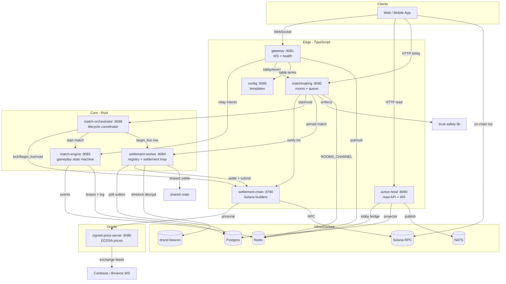
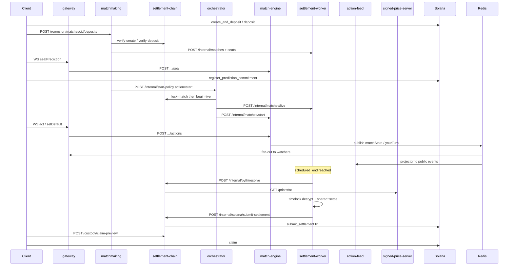
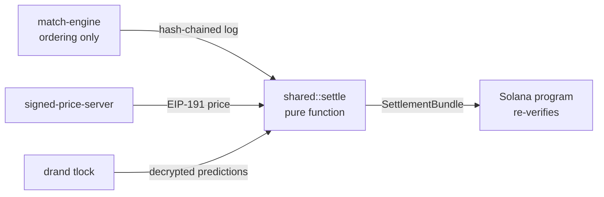
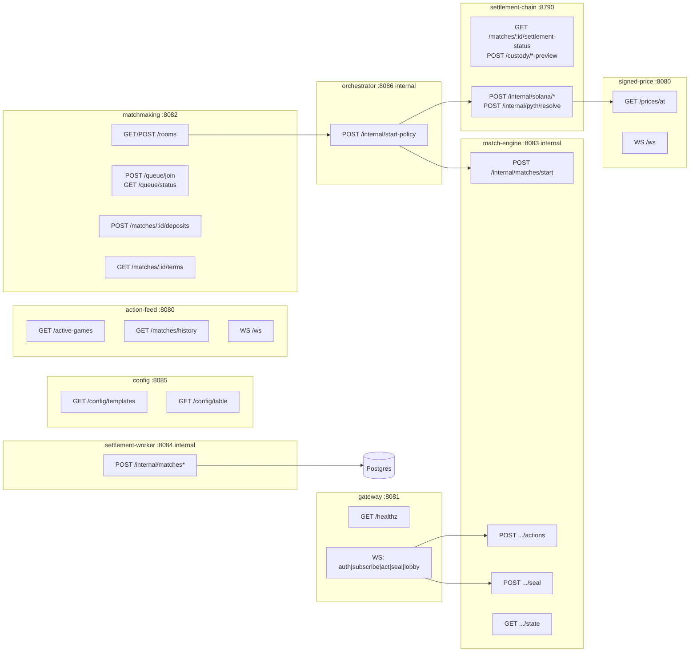

# Syndicate Backend — System Architecture & API Map

Canonical reference for service topology, inter-service flows, and every HTTP/WebSocket API surface. Derived from route handlers in each service's `main.ts` / `server.rs` and [deploy/docker-compose.app.yml](../../deploy/docker-compose.app.yml) for default ports.

**Related:** [ARCHITECTURE.md](../../ARCHITECTURE.md) (trust model & service ownership), [docs/frontend/protocol.ts](../frontend/protocol.ts) (client wire types).

---

## Non-HTTP components

These have no REST/WebSocket surface:

| Component | Role |
|-----------|------|
| `shared` | Deterministic settlement math (Rust crate) |
| `settlement` | Off-chain settlement builder (Rust lib; called by worker) |
| `timelock` | drand seal/decrypt (Rust lib; called by worker/engine) |
| `store` | Postgres queries (Rust lib; exposed via worker registry HTTP) |
| `trust-safety` | Enforcement library embedded in matchmaking (`canJoinTable`) |
| `programs` | Solana Anchor contract (on-chain instructions, not HTTP) |

---

## Default ports (docker-compose)

| Service | Port | Stack |
|---------|------|-------|
| action-feed | 8080 | TypeScript |
| gateway | 8081 | TypeScript |
| matchmaking | 8082 | TypeScript |
| match-engine | 8083 | Rust |
| settlement-worker | 8084 | Rust |
| config | 8085 | TypeScript |
| match-orchestrator | 8086 | Rust |
| signed-price-server | 8080 (internal) | Go |
| settlement-chain | 8790 | TypeScript |

---

## 1. Container architecture

---

## 2. Match lifecycle sequence

---

## 3. Trust model

The match engine sequences actions and runs timers but is **not trusted for outcomes**. Settlement is recomputed via `shared::settle()` and re-verified on-chain before funds move. Disagreement → VOID, not payout.

---

## 4. Gateway — WebSocket protocol (player-facing)

**Source:** [services/gateway/src/server.ts](../../services/gateway/src/server.ts), [services/gateway/src/relay.ts](../../services/gateway/src/relay.ts)

### HTTP

| Method | Path | Response |
|--------|------|----------|
| GET | `/healthz` | `{ ok: true }` |
| GET | `/metrics` | Prometheus text |

### WebSocket

Upgrade on the same port (no path). Flow: challenge nonce → `auth` → authenticated gameplay relay.

| Client → Server | Key inputs | Server → Client |
|-----------------|------------|-----------------|
| (on connect) | — | `{ type: "challenge", nonce }` |
| `auth` | `wallet`, `signature` (ed25519 over nonce) | `{ type: "authenticated", wallet }` or `{ type: "error", reason }` |
| `ping` | — | `{ type: "pong", serverTime }` |
| `subscribe` | `matchId` | `tableTerms`, `matchState` (+ deadlines) |
| `subscribeLobby` | optional `feed`, `template`, `buyIn` | `lobbyList` + push `roomsUpdated` |
| `subscribeRoom` | `matchId` | auto `matchStarted` on FILLING→LIVE |
| `sealPrediction` | `matchId`, `ciphertext`, `seatIndex`, `targetRound`, `commitmentHex`, `blindingHex`, `signature` | engine events via Redis fan-out |
| `act` | `matchId`, `action`, `signature`, `seatIndex`, `nonce`, `prevHeadHex` | `matchState`, `yourTurn` |
| `setDefault` | `matchId`, `default`, `signature`, `seatIndex` | `{ ok }` via engine |
| `fetchLobby` | `roomCode` | `{ type: "lobbyState", lobby }` |
| `fetchQueueStatus` | `tierId`, `feedId`, `token`, `buyIn?` | `{ type: "queueStatus", status }` |

**Push events** (from Redis): `matchState`, `yourTurn`, `settled`, `void`, `event`, `roomsUpdated`, `matchStarted`. All outbound messages include `serverTime` for client clock sync.

---

## 5. Per-service HTTP API catalog

### matchmaking `:8082`

**Source:** [services/matchmaking/src/main.ts](../../services/matchmaking/src/main.ts)

| Method | Path | Purpose | Request | Response |
|--------|------|---------|---------|----------|
| GET | `/healthz` | Liveness | — | `{ ok: true }` |
| GET | `/metrics` | Prometheus | — | text |
| GET | `/rooms` | List forming rooms | query: `feed?`, `template?`, `buyIn?` | `{ rooms: RoomSummary[] }` |
| POST | `/rooms` | Report host create tx | `{ createTxSig, matchPda, onchainMatchId, configHash, wallet, seatIndex?, maxPlayers? }` | `{ ok, matchId?, roomCode?, reason? }` — 201 or 409 |
| GET | `/rooms/:code` | Room lobby | query: `wallet?` | `{ lobby: RoomLobby }` |
| POST | `/rooms/:code/start` | Host starts match | `{ host }` | `{ ok, reason? }` |
| POST | `/rooms/:code/join` | Resolve matchId | — | `{ matchId }` |
| POST | `/queue/join` | Join public queue | `{ tierId?, feedId?, token?, wallet, rating?, buyIn?, fillWindowSec? }` | queue assignment object |
| GET | `/queue/status` | Queue snapshot | query: `tier`, `feed`, `token`, `rating`, `buyIn?`, `fillWindowSec?` | `{ status: QueueStatus }` |
| POST | `/matches/:matchId/deposits` | Verify deposit tx | `{ wallet, depositTxSig, seatIndex?, tierId?, feedId? }` | `{ ok, reason?, seatIndex? }` |
| GET | `/matches/:matchId/terms` | Table terms | — | `{ terms: TableTerms }` or 404 |

---

### match-engine `:8083` (internal)

**Source:** [services/match-engine/src/server.rs](../../services/match-engine/src/server.rs)

Called by gateway (player intents) and orchestrator (match start). Not exposed to clients directly.

| Method | Path | Purpose | Request body | Response |
|--------|------|---------|--------------|----------|
| GET | `/healthz` | Liveness | — | `{ ok: true }` |
| GET | `/metrics` | Prometheus | — | text |
| POST | `/internal/matches/start` | Begin LIVE engine | `matchId`, `onchainMatchId?`, `players[]` (`seatIndex`, `stack`, `sealSeq`, `wallet`), `button`, `smallBlind`, `bigBlind`, `roundCount`, `roundDurationsSec[]`, `observationWindowsSec[]`, `actionTimeoutMs`, `timeBankSec`, `liveStartTs` | `{ ok, matchId }` or `{ error }` |
| POST | `/internal/matches/:id/actions` | Bet or register default | `{ wallet, action?, default?, signature, seatIndex?, nonce?, prevHeadHex? }` | `{ ok: true }` or `{ error }` |
| POST | `/internal/matches/:id/seal` | Record sealed prediction | `{ wallet?, playerId?, targetRound?, ciphertext, commitmentHex?, blindingHex?, signature? }` | `{ ok: true }` |
| GET | `/internal/matches/:id/state` | Authoritative snapshot | — | `{ matchId, phase, round, pot, toActSeat, nodeId }` |

**Action JSON** (in `action` field): `{ type: "fold" }`, `"check"`, `"call"`, `{ type: "betTo", amount }`, `{ type: "raiseTo", amount }`, `"allIn"`.

**Default policy** (in `default` field): `"check_fold"` / `"checkFold"` or `"check_call_any"` / `"checkCallAny"`.

---

### match-orchestrator `:8086` (internal)

**Source:** [services/match-orchestrator/src/main.rs](../../services/match-orchestrator/src/main.rs)

Coordinates lock → begin_live → engine start (or void-before-start). Auth: `Authorization: Bearer` (same token as settlement-chain internal routes).

| Method | Path | Purpose | Request | Response |
|--------|------|---------|---------|----------|
| GET | `/healthz` | Liveness | — | `{ ok: true }` |
| POST | `/internal/start-policy` | Lifecycle coordinator | `{ matchId, onchainMatchId?, result: { action: "start" \| "void", reason?, trigger? }, players[], button?, smallBlind?, bigBlind?, roundCount?, roundDurationsSec[], observationWindowsSec[], actionTimeoutMs?, timeBankSec? }` | start: `{ ok, button, liveStartTs, scheduledEndTs }` · void: `{ ok: true }` |

---

### config `:8085`

**Source:** [services/config/src/main.ts](../../services/config/src/main.ts)

| Method | Path | Purpose | Query / body | Response |
|--------|------|---------|--------------|----------|
| GET | `/healthz` | Liveness | — | `{ ok: true }` |
| GET | `/config/catalog` | Full catalog | — | catalog object |
| GET | `/config/templates` | Allowlisted templates | — | `{ templates[], allowlist[] }` |
| GET | `/config/template/:hash` | One template | path: `config_hash` hex | `{ template }` or 404 |
| GET | `/config/table` | Player-facing terms | `matchId?`, `tierId`, `feedId`, `onchainMatchId?`, `matchPda?`, `timelockTargetRound?`, `buyIn?`, `fillWindowSec?` | `{ terms: TableTerms }` |
| GET | `/config/tier/:tierId` | Tier for feed | `feedId` | `{ tier }` |

---

### action-feed `:8080`

**Source:** [services/action-feed/src/server.ts](../../services/action-feed/src/server.ts)

Read-only public surface. Never exposes sealed predictions, queued intents, or pre-signed defaults.

| Method | Path | Purpose | Query / body | Response |
|--------|------|---------|--------------|----------|
| GET | `/healthz` | Liveness | — | `{ ok: true }` |
| GET | `/metrics` | Prometheus | — | text |
| GET | `/active-games` | Live dashboard | — | `{ games: LiveGame[] }` |
| GET | `/upcoming-games` | Forming matches | — | `{ games: FormingGame[] }` |
| GET | `/matches/history` | Paginated history | `status?` (`live`/`settled`/`voided`/`all`), `limit?` (1–100), `cursor?` | `{ matches[], nextCursor? }` |
| GET | `/matches/:id/history` | One match summary | — | `{ match, oracleProof }` |
| GET | `/matches/:id/actions` | Redacted action log | — | `{ matchId, events[] }` |
| GET | `/matches/:id/replay` | Replay bundle | — | `{ bundle, oracleProof }` |
| GET | `/leaderboard` | Player rankings | — | `{ entries[] }` |
| GET | `/profiles/:wallet` | Public profile | — | `{ profile }` |
| PUT | `/profiles/me` | Update handle/avatar | `{ wallet, handle?, avatarUri? }` | `{ profile }` |
| WS | `/ws?matchId?` | Public events stream | optional match filter | `{ type: "event", event }` or `{ type: "lobby", phase, game }` |

---

### settlement-chain `:8790`

**Source:** [services/settlement-chain/src/main.ts](../../services/settlement-chain/src/main.ts)

#### Public (no auth)

| Method | Path | Purpose | Request | Response |
|--------|------|---------|---------|----------|
| GET | `/health` | Status | — | `{ ok, signer, programId, signedPriceServerUrl }` |
| GET | `/metrics` | Prometheus | — | text |
| GET | `/matches/:id/settlement-status` | Claim/refund eligibility | query: `wallet?`, `onchainMatchId?` | settlement status object |
| POST | `/custody/claim-preview` | Build claim instruction | `{ matchId, wallet, onchainMatchId? }` | unsigned tx preview |
| POST | `/custody/refund-preview` | Build refund instruction | `{ matchId, wallet, onchainMatchId? }` | unsigned tx preview |

#### Internal (`Authorization: Bearer` required)

| Method | Path | Purpose | Key inputs | Response |
|--------|------|---------|------------|----------|
| POST | `/internal/pyth/resolve` | Fetch signed price at match end | `{ symbol, scheduledEndTs, feedIdHex? }` | `{ available, price?, signed_price? }` or 404 |
| POST | `/internal/solana/create-match` | Create match ix | `CreateMatchInput` | tx sig or preview |
| POST | `/internal/solana/lock-match` | Lock for sealing | `{ matchId, onchainMatchId }` | tx + `sealDeadlineTs` |
| POST | `/internal/solana/begin-live` | Go LIVE on-chain | `{ onchainMatchId, seatWallets?, buttonRandomnessHex? }` | `{ button, liveStartTs, scheduledEndTs, lockTs, sealedCount, ... }` |
| POST | `/internal/solana/deposit` | Deposit preview | `{ wallet, seatIndex, onchainMatchId }` | unsigned tx |
| POST | `/internal/solana/create-and-deposit` | Combined create+deposit | `CreateMatchInput` + `wallet`, `seatIndex` | unsigned tx |
| POST | `/internal/solana/register-commitment` | Seal commitment ix | `{ wallet, commitmentHex, timelockTarget, onchainMatchId }` | unsigned tx |
| POST | `/internal/solana/verify-deposit` | RPC verify deposit | `{ txSig, wallet, onchainMatchId, seatIndex? }` | `{ ok, reason?, ... }` |
| POST | `/internal/solana/verify-create` | RPC verify create | `{ txSig, wallet, onchainMatchId, seatIndex? }` | `{ ok, reason?, ... }` |
| POST | `/internal/solana/enumerate-seats` | Chain seat set | `{ onchainMatchId }` | `{ ok, matchPda, seats[] }` |
| POST | `/internal/solana/void-before-start` | Permissionless void | `{ onchainMatchId }` | tx sig |
| POST | `/internal/solana/void-live-after-deadline` | Deadline void | `{ onchainMatchId }` | tx sig |
| POST | `/internal/solana/submit-settlement` | On-chain settle | `{ bundle, signedPrice, match: { onchainMatchId, seatWallets[] } }` | `{ txSig, signedPrice, mode }` |
| POST | `/internal/solana/void-match` | Admin emergency void | `{ match }` | `{ txSig }` |
| POST | `/internal/solana/withdraw-fees` | Treasury rake | `{ onchainMatchId, treasuryToken }` | tx sig |
| POST | `/internal/solana/claim-preview` | Internal claim preview | `{ matchId, wallet, onchainMatchId? }` | unsigned tx preview |
| POST | `/internal/solana/refund-preview` | Internal refund preview | `{ matchId, wallet, onchainMatchId? }` | unsigned tx preview |

---

### settlement-worker `:8084`

**Source:** [services/worker/src/registry_http.rs](../../services/worker/src/registry_http.rs), [services/worker/src/health.rs](../../services/worker/src/health.rs)

Registry HTTP is called by matchmaking/orchestrator. Background loop (no HTTP): Postgres/NATS poller → `shared::settle()` → settlement-chain submit.

| Method | Path | Auth | Purpose | Request | Response |
|--------|------|------|---------|---------|----------|
| GET | `/healthz` | — | Liveness | — | `{ ok: true }` |
| GET | `/metrics` | — | Prometheus | — | text |
| POST | `/internal/matches` | Bearer | Insert match row | `matchKey`, `onchainMatchId`, `configHash`, `fillDeadlineMs`, `priceFeedSymbol`, `oracleTokenHex`, `oracleExponent?`, `maxOracleConfidence?`, `buyInChips`, `entryFeeChips?`, `rakeBps`, `rakeCapChips`, `maxPlayers` | `{ ok, matchId, matchKey, roomStatus }` |
| POST | `/internal/matches/seats` | Bearer | Insert seat | `matchKey`, `seatIndex`, `wallet`, `depositSignature`, `buyInChips`, `entryFeeChips?` | `{ ok, matchId, seatIndex }` |
| POST | `/internal/matches/live` | Bearer | Stamp LIVE timing | `matchId`, `liveStartTs`, `scheduledEndTs`, `lockTs`, `sealDeadlineTs`, `sealedCount`, `nonsealPenaltyBps?` | `{ ok, matchId }` |

---

### signed-price-server `:8080`

**Source:** [services/signed-price-server/api/server.go](../../services/signed-price-server/api/server.go), [handlers.go](../../services/signed-price-server/api/handlers.go)

| Method | Path | Purpose | Inputs | Response |
|--------|------|---------|--------|----------|
| GET | `/health` | Health + WS metrics | — | `{ ok, status, websocket, book_mid?, failover? }` |
| GET | `/prices` | Latest signed prices | `symbols?` (comma-separated) | `{ prices[], count, timestamp }` |
| GET | `/prices/at` | Exact-second lookup (settlement) | `symbol`, `timestamp` (unix seconds) | `{ price: SignedPrice, symbol, timestamp }` or 404 |
| WS | `/ws` | Live price stream | `symbols?` | `connected` message + `SignedPrice` JSON frames |
| POST | `/internal/failover/promote` | HA failover (ops) | — | failover status |
| POST | `/internal/failover/demote` | HA failover (ops) | — | failover status |
| GET | `/internal/failover/status` | HA status | — | failover snapshot |

**SignedPrice** response fields: `token`, `symbol`, `price`, `price_in_wad`, `timestamp` (ms), `trade_id`, `exchange`, `v`, `r`, `s`, `public_key`, `signed_at`, optional `meta` (bid/ask/book_age_ms for book_mid).

---

## 6. Service API map (compact)

---

## 7. Client entry points summary

| Audience | Primary surface | Notes |
|----------|-----------------|-------|
| Players (gameplay) | gateway WebSocket `:8081` | Auth, bets, seal relay; state pushed via Redis |
| Players (lobby/deposit) | matchmaking HTTP `:8082` | Rooms, queue, deposit verification |
| Players (claim/refund) | settlement-chain HTTP `:8790` | `/custody/*-preview` + on-chain tx |
| Spectators / dashboard | action-feed HTTP/WS `:8080` | Public events only; no secrets |
| Config / templates | config HTTP `:8085` | `config_hash` allowlist for creates |
| Operators / internal | orchestrator, worker, settlement-chain `/internal/*` | Bearer auth required |
